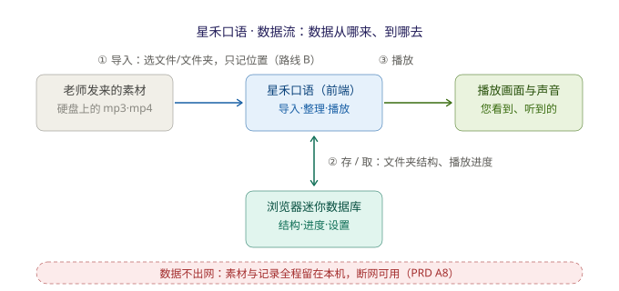

# 星禾口语 · 技术设计（TECH_DESIGN）

> 版本：v3.0（Day 18，技术路线由 PWA 切为 Flutter 独立 App）｜ 上游文档：PRD.md（Day 4 起）、research.md（Day 3）｜ 范围：Day 7 MVP「一心复读机 promax」
>
> **v3.0 变更记录**：应 Day 13 产品方向调整（Flutter 独立 App 落地，applicationId `com.xinghe.kouyu`），技术路线由「PWA + IndexedDB」改为「**Flutter + sqflite 本地库**」。核心原则（离线优先、无后端）不变，仅载体与存储从浏览器技术栈迁移到 Flutter 技术栈。

## 1. 技术路线

**选定：Flutter 独立 App + sqflite 本地数据库**

两句话：
- **形态**：以 Flutter 构建的**原生 App**（安卓为当前验收平台），打包成 `.apk` 安装，点图标启动，断网可用，用起来就是一个独立应用；
- **存储**：素材导入时**复制一份**进 App 私有目录（`path_provider` 定位），元数据、文件夹结构、播放位置全部存 **sqflite（SQLite）**，播放、整理不依赖原文件位置。

### 为什么这样选

1. **「手机端为主、电脑端兼容」**：Flutter 一套 Dart 代码通吃安卓/iOS（本期以安卓真机验收，与目标用户场景一致）。
2. **「独立 App 形态」**：原生 App 自带图标、全屏启动、无浏览器痕迹，是真正的独立应用，体验优于 PWA。
3. **「统一复制 + 本地库」**：素材复制进私有目录，元数据落 SQLite，一套逻辑通吃多端；离线优先（local-first），数据永远先落本地，联网同步是将来班级管理阶段才加的事。

### 技术栈

| 用途 | 选型 |
|---|---|
| 状态管理 | Provider |
| 导航 | Navigator 栈式导航 |
| 本地数据库 | sqflite（SQLite） |
| 音频播放 | just_audio |
| 视频播放 | video_player |
| 文件选择 | file_picker |
| 文件路径 | path_provider + path |

### 已知代价与风险备案

| 代价 / 风险 | 说明 | 应对 |
|---|---|---|
| 桌面端（Windows）跑不了 | sqflite 在 Windows 需 ff i 版（sqflite_common_ffi），其 sqlite3 依赖会去 GitHub 下载被墙 | 本阶段只在安卓真机验收；桌面端列为待办 |
| 大视频导入等待 | 复制需要时间，视频越大越久 | 导入时显示进度提示；音频文件小，不受影响 |
| 存储容量 | 手机存储有限 | 素材以老师发的一段段音频为主，量级可控 |

## 2. 前后端与数据库分工

| 角色 | 本项目的安排 | 说明 |
|---|---|---|
| 前端 | **星禾口语应用（唯一角色，Dart 代码）** | 素材导入、应用内文件夹管理、播放/变速/AB 复读、位置记忆，全部由 App 本地完成 |
| 后端 | **无** | MVP 不设后端。没有服务器，所以没有广告位（F7 天然成立），数据也无处可去 |
| 应用存储 | **sqflite（SQLite）充当本地数据库** | 存三样东西：**素材元数据**（含文件路径、时长）、**应用内文件夹结构**、**播放位置记录**；素材文件本体另存 App 私有目录 |

**这个分工的直接后果**：
- A8「页面加载后断网，全功能可用」成立——素材副本就在本机，一切不依赖网络；
- 远期扩展功能（班级管理、实时字幕统计、汇报老师）全部需要后端（多人的数据要汇到一处）——这正是它们被划入「本期不做」的技术根源。

## 3. 数据流

**一句话说清数据从哪来、到哪去**：数据从「老师发来的本地音视频文件」来，导入时复制一份进 App 私有目录，此后只在您的设备里流转（整理、播放、记进度），最后以画面和声音回到您的眼睛和耳朵——**全程不出网**。

## 4. 关键技术点

- **Provider 状态管理**：素材仓库等共享状态挂在应用顶层，各页面统一读写；
- **sqflite**：本地 SQLite 数据库，存素材元数据、文件夹树、播放位置（`materials.last_position`）；
- **just_audio / video_player**：音频、视频播放，变速用 `setSpeed` / `setPlaybackSpeed`，AB 循环靠监听播放位置 + `seek`；
- **file_picker**：系统文件选择器，替代浏览器的文件选择；
- **离线优先**：无需服务器计算能力，纯本地运行。

## 5. 后期升级路径（本期不做，仅记录方向）

- 桌面端打包：sqflite 的 Windows 版依赖 sqlite3 下载被墙，需另找方案后再支持；
- 多端同步 / 班级管理：需要引入后端（届时同步修订本文件与 PRD 不做清单）。
